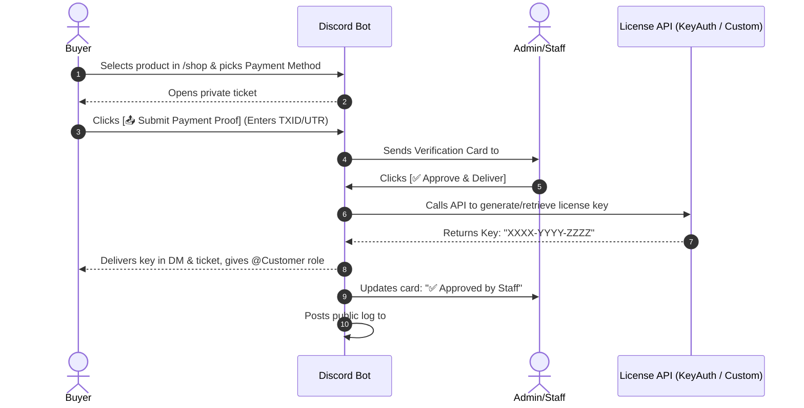

# 🛒 Discord Auto Sell Bot

A modern, high-performance Discord Auto Sell Bot featuring **Manual Payment Verification** and **Automated License Key Delivery via API** (supporting both **Custom REST API** & **KeyAuth Seller API**, plus local stock pools).

---

## ✨ Features

- 💳 **Manual Payment Verification Flow**:
  - Buyer clicks **Buy** on any product in your store channel.
  - Buyer selects payment method (Crypto, UPI / QR, PayPal, Bank / CashApp).
  - Private **Order Ticket Channel** (`#order-xxxx`) or DM interactive interface is created.
  - Buyer sends payment and clicks **"📤 Submit Payment Proof"** modal (Transaction ID / UTR / screenshot link).
- 🔔 **Staff Verification Channel**:
  - Staff gets an instant review embed with customer tag, product, amount, payment method, and Transaction ID.
  - Interactive buttons: **`[ ✅ Approve & Deliver ]`** and **`[ ❌ Decline ]`**.
- ⚡ **Automated License API Delivery**:
  - **KeyAuth API Integration**: Automatically generates license keys on approval using KeyAuth Seller API with custom expiry, mask, and level.
  - **Custom REST API**: Sends HTTP `POST`/`GET` requests to your own license server endpoint with authorization tokens and extracts the generated license key.
  - **Local Stock Pool**: Alternatively pop pre-generated keys from your local stock database.
- 📬 **Instant Delivery & Roles**:
  - Automatically delivers the license key to the buyer in their **Discord DMs** and ticket channel inside a spoiler (`||KEY||`).
  - Automatically grants the configured **Customer Role** upon approval.
  - Logs completed sales in a public **Sales Log Channel**.
  - If declined, prompts staff for a reason and notifies the buyer.
- 📊 **Statistics & Order Tracking**:
  - `/order view <id>`: Look up any order and its delivery key, TXID, and status.
  - `/order stats`: Check total revenue, completed sales, and pending verifications.

---

## 🛠️ Step 1: Discord Bot Setup & Intents

1. Visit the [Discord Developer Portal](https://discord.com/developers/applications).
2. Click **New Application** and give your bot a name.
3. Go to the **Bot** tab:
   - Click **Reset Token** and copy your **Bot Token**.
   - Under **Privileged Gateway Intents**, turn **ON**:
     - ✅ **Server Members Intent**
     - ✅ **Message Content Intent**
   - Save Changes.
4. Go to **OAuth2** tab:
   - Copy your **Client ID** (Application ID).
   - Under **OAuth2 URL Generator**:
     - Select scopes: `bot`, `applications.commands`
     - Select bot permissions: `Administrator` (or *Manage Channels, Manage Roles, Send Messages, Embed Links, Attach Files, Read Message History*).
     - Copy the generated URL and open it in your browser to invite the bot to your server.

---

## ⚙️ Step 2: Configure `.env`

Open the `.env` file in the project folder and paste your credentials:

```env
DISCORD_TOKEN=your_bot_token_here
CLIENT_ID=your_client_id_here
GUILD_ID=your_server_id_here

# Optional defaults
KEYAUTH_SELLER_KEY=
CUSTOM_API_URL=
```

> **Tip:** Adding your `GUILD_ID` allows Discord slash commands to sync **immediately** for your server without the global 1-hour cache delay.

---

## 🚀 Step 3: Run the Bot

In your terminal/PowerShell, run:

```bash
npm start
```

You should see:
```text
🔄 Refreshing 6 application (/) commands...
✅ Successfully registered slash commands for Guild ID: ...
🤖 Logged in as: YourBot#1234
```

---

## 📋 Step 4: Server Setup via Slash Commands

Run these commands in your Discord server:

### 1. Configure Channels & Roles
```bash
/setup channels verification_channel:#staff-verify log_channel:#sales-logs ticket_category:ORDERS
/setup role customer_role:@Customer
/setup mode mode:Ticket Channel
```

### 2. Configure Payment Methods
```bash
# Configure Cryptocurrency (USDT, LTC, BTC)
/payment config method:crypto enabled:True details:USDT (TRC20): TYourAddressHere\nLTC: LYourLtcAddress

# Configure UPI / QR
/payment config method:upi enabled:True details:UPI ID: yourname@upi\nScan QR or pay via GPay/PhonePe

# Configure PayPal
/payment config method:paypal enabled:True details:https://paypal.me/yourusername (Friends & Family only)
```

To view active payment methods:
```bash
/payment view
```

### 3. Add Products

#### Option A: Product with KeyAuth API
```bash
# 1. Add product
/product add id:vip-monthly name:VIP Cheat 30 Days price:15 delivery_type:KeyAuth API currency:USD

# 2. Configure KeyAuth Seller API
/product config_keyauth id:vip-monthly seller_key:your_seller_key expiry:30 mask:KEY-XXXXXX-XXXXXX level:1
```

#### Option B: Product with Custom REST API
```bash
# 1. Add product
/product add id:spoofer name:HWID Spoofer Lifetime price:25 delivery_type:Custom REST API currency:USD

# 2. Configure your custom API endpoint
/product config_api id:spoofer url:https://api.yourdomain.com/v1/license/generate method:POST api_key:your_secret_bearer_token response_key_path:data.license_key
```

#### Option C: Product with Local Stock Pool
```bash
# 1. Add product
/product add id:nitro name:Discord Nitro 1 Month price:5 delivery_type:Local Stock Pool

# 2. Add keys to inventory
/stock add product_id:nitro keys:NITRO-KEY-1111, NITRO-KEY-2222, NITRO-KEY-3333
```

---

## 🛒 Step 5: Post the Shop in your Store Channel

In your shop channel (e.g. `#shop` or `#buy-here`), run:

```bash
/shop send channel:#shop
```

The bot will post an interactive store catalog with a dropdown menu where customers can select any product and start buying!

---

## 🔄 Complete Buyer & Staff Walkthrough



---

## 📁 File Structure

```
├── .env                  # Bot Token & IDs
├── .env.example          # Environment template
├── config.json           # Optional configuration
├── index.js              # Bot entrypoint & event registry
├── package.json          # Dependencies & scripts
├── database/
│   ├── db.js             # Atomic persistent JSON database
│   └── data/             # products.json, orders.json, settings.json, stock.json
├── services/
│   ├── licenseService.js # KeyAuth API, Custom REST API & Stock delivery
│   └── ticketService.js  # Private order ticket channels
├── handlers/
│   ├── interactionHandler.js # Slash commands, buttons, menus & modals
│   ├── purchaseFlow.js       # Payment selection & proof modal
│   └── adminVerifyFlow.js    # Approve/Decline staff actions
└── commands/
    ├── shop.js           # /shop send
    ├── product.js        # /product add, config_api, config_keyauth, list, delete
    ├── stock.js          # /stock add, view, clear
    ├── payment.js        # /payment config, view
    ├── order.js          # /order view, stats
    ├── setup.js          # /setup channels, role, mode, view
    └── help.js           # /help command
```
